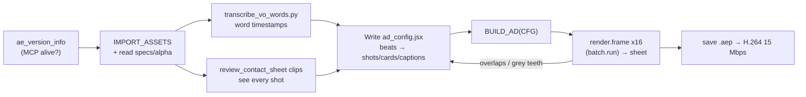

# 19 — Dental Product Ad Workflow (Clean · Minimal · 9:16)

A repeatable pipeline for **professional, minimalist dental product ads** built from
alpha-channel 3D product renders, a French VO, white pop-up explainer cards and
word-synced captions. Proven on **i-LINER (i-dental) for Syphax Medico Dentaire**
(58 s, 1080×1920, 60 fps, built 100 % through After Effects MCP in ~20 min).

Reference implementation:
- Builder library → [`scripts/dental_product_ad_builder.jsx`](../scripts/dental_product_ad_builder.jsx)
- Example config (i-LINER) → [`projects/iliner-dental-ad-v2/ad_config.jsx`](../projects/iliner-dental-ad-v2/ad_config.jsx)
- Dual-comp Master + 18s Reel builder (i-FIX® Duo) → [`projects/ifix-duo-dental-ad/build_ifix_duo.jsx`](../projects/ifix-duo-dental-ad/build_ifix_duo.jsx)
- 3D clinical interventions & IFU compliance guide → [`docs/21-clinical-dental-3d-and-ifu-compliance.md`](21-clinical-dental-3d-and-ifu-compliance.md)
- VO word timing → [`scripts/transcribe_vo_words.py`](../scripts/transcribe_vo_words.py)
- Visual QA sheets → [`scripts/review_contact_sheet.py`](../scripts/review_contact_sheet.py)

---

## 1. Expected client folder

```
<Product>_Project/
├── ALL_VIDEOS/            # Blender renders, .mov ProRes 4444 w/ alpha (premultiplied), 1080x1920 @60
├── ASSETS_AND_PROJECTS/   # logos (*_crisp.png = clean cut-out), banner photos, old .aep/.blend
└── VO_AND_SCRIPT/         # ElevenLabs .mp3 + VO_SCRIPT.txt (source of truth for caption text)
```

Shot naming that worked: `NN_subject_action.mov` (`01_box_hero_drift`, `12a_tooth_composite`),
`v3_` prefix = newer re-render (prefer it when both exist), `*_alpha.mov` 4K turntables for end cards.

## 2. Pipeline (≈ 8 tool round-trips)



1. **Connect:** `ae_version_info`. `eval.run` must be ENABLED in `ae_catalog`.
2. **Import:** `IMPORT_ASSETS(CFG)` – wraps every import in try/catch (a corrupt JPG killed the first batch).
   Check `item.mainSource.hasAlpha` / `alphaMode` (on `mainSource`, not the item → that returns null).
3. **VO timing:** `python scripts/transcribe_vo_words.py vo.mp3 --lang fr`.
   Use Whisper **only for timings**; caption text comes from `VO_SCRIPT.txt`
   (Whisper wrote "Highliner"/"CIFACS" for i-LINER/Syphax).
4. **See the footage:** `python scripts/review_contact_sheet.py clips ALL_VIDEOS sheet.jpg`.
5. **Map beats → shots** (see §3), write `ad_config.jsx`.
6. **Build:** `$.evalFile(lib); $.evalFile(cfg); return BUILD_AD(CFG);` – idempotent (deletes & rebuilds the comp).
7. **QA:** one `batch.run` with ~16 `render.frame` children (one per beat + transitions), tile with
   `review_contact_sheet.py frames`, look, fix config, rebuild. 2 iterations were enough.
8. **Deliver:** `project.save` → render queue → `render.set_output` with
   `"H.264 - Match Render Settings - 15 Mbps"` + `"Best Settings"` → `render.start`.
   58 s @ 60 fps took ~3 min; the MCP call times out at 3 min but **AE keeps rendering** – just poll the file.

## 3. Narrative structure for a dental material ad (FR)

| Beat | VO pattern | Shots | Graphics |
|---|---|---|---|
| Hook / identity | "X de i-dental, le liner …" | box hero drift, label macro | Big kinetic product name + category subline |
| What it is | "matériau de fond de cavité…" | tray slide-out, top-down reveal | 1 card per claim (Photopolymérisable, Type compomère, Durabilité) |
| Formulation | "résines… + verre ionomère" | syringe hero, barrel label | 2 stacked cards, 2nd with "+" in accent |
| Properties | "radio-opacité, dentine" | exploded tooth layers | Cards placed beside the tooth |
| Question break | "Quelles sont ses indications ?" | **no footage** – type only | Centered label + 104 px headline |
| Indications | "sous composites / amalgame / porcelaine" | 12a/12b/12c tooth cut-aways | Numbered cards `01 02 03` (number in accent) |
| Usage modes | "deux façons : liner / revêtement" | liner-floor vs full-coat tooth | `1` / `2` cards + benefit card |
| CTA | "Disponible chez Syphax…" | 4K box turntable, **hold last frame** | DISPONIBLE CHEZ + logo + phone numbers |

Captions are chunked at 2–6 words on natural pauses; key terms are tinted with the accent.

## 4. Design system (minimal medical)

| Token | Value |
|---|---|
| Background | Radial ramp `#F9F9FB` (center, y≈43 %) → `#DADDE2` (edge) |
| Ink / Gray | `#1B1E26` / `#6B7380` |
| Accent | Product brand colour (i-LINER magenta `#D6177A`). One accent only. |
| Font | Montserrat: ExtraBold headlines, Bold card titles, SemiBold captions/labels, Medium subs |
| Card | White, radius 26, 7 px accent bar, padding 38, shadow 14 % / dist 14 / soft 50 |
| Caption | 46 px on white pill (82 % opacity), y = 1470, auto-shrink above 900 px width |
| Headline label | 27 px, tracking 260, accent, uppercase |
| Motion | Cards: +26 px rise, 94→100 % scale, 0.55 s ease 85 %. Text: per-char offset reveal, smoothness 100. Shots: 96.5→100→103 % slow push, 0.22 s cross-dissolve |

**9:16 safe zones:** keep cards between y 260 – 1400, captions at 1470 (IG bottom UI starts ~1536).
Top zone y 300–440 is the default card slot; move cards sideways (x 330 / 730) when the product fills the centre.

## 5. Lessons / gotchas (read before the next product)

- **Translucent teeth go grey** on a light background when a Drop Shadow is applied (shadow shows through
  the enamel). → `noShadow: 1` on every tooth clip, plus `brighten: 38` (Brightness & Contrast) on the
  older `10_`/`12x_` renders.
- **Syringes enter from the top-right** in the application shots → no top-centre headline there; put the
  card at x 330.
- **Long headlines collide with tall products** (syringe hero spans the full height). Prefer cards
  over headlines during product shots; save big type for the question break and the intro.
- Clip shorter than its beat → builder applies a gentle time-stretch (≤ ~125 % still looks fine at 60 fps
  source). For end-card turntables use **time-remap hold**:
  `Math.min(time - inPoint, source.duration - thisComp.frameDuration)`.
- `comp.saveFrameToPng` from `eval.run` is async and fails silently if the folder doesn't exist →
  use the `render.frame` op inside `batch.run` instead.
- A failed `eval.run` can leave half-built solids; the builder deletes the old comp, then
  clean unused solids (`usedIn.length == 0`) before saving.
- Layer order inside a card: create title → sub → card shape, then `card.moveAfter(title)`
  (an earlier `moveAfter(sub)` put the card *over* the title).
- Locked layers can't be moved – lock the BG **after** `moveToEnd()`.
- Text colour ranges: `textDocument.characterRange(a, b).fillColor = ACC` then `setValue(td)` (AE 24.3+).
- Drop Shadow opacity is set on a 0–255 scale internally (`op * 2.55`).
- Keep claims strictly to the client script (medical device ad). Anything added (e.g. "Visible en
  radiographie") must be flagged to the client.
- Phone numbers/contacts can be lifted from the client's banner photo – always ask to confirm.

## 6. New product checklist

1. Copy `projects/iliner-dental-ad-v2/ad_config.jsx` → `projects/<product>/ad_config.jsx`.
2. Set `ROOT`, `compName`, `brand.accent` (sample the product label colour), assets.
3. Run transcription, paste chunk timings into `captions`, align `scenes` cuts to sentence starts.
4. Write 1 card per factual claim (title ≤ 3 words, sub ≤ 5 words).
5. Build → 16-frame QA sheet → fix → render. Commit the config + a `README.md` with lessons.
