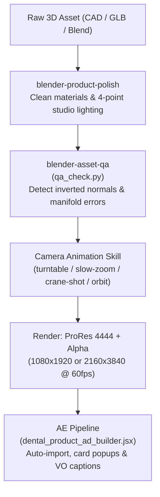

# 20 — Blender 3D Product Rendering & Agent Skills Pipeline

How to prepare, animate, QA, and export 3D product renders in Blender for seamless integration into After Effects motion workflows.

This architecture integrates three battle-tested agent skill suites:
1. **[EL4CTEO/blender-skills](https://github.com/EL4CTEO/blender-skills)** (`vendor/el4cteo-blender-skills`): Comprehensive Blender 5.x production pipeline, modern `bpy` API patterns, PBR materials, and automated mesh QA diagnostics.
2. **[kevinbadi/blender-skills](https://github.com/kevinbadi/blender-skills)** (`vendor/blender-skills`): Product showcase camera rigs (turntable, slow-zoom, dolly-rotate, crane-shot, loops) and automated studio lighting polish.
3. **[arjun988/blender-skills](https://github.com/arjun988/blender-skills)** (`vendor/arjun-blender-skills`): Massive 94-skill Senior Technical Art suite featuring `blender-director` routing, reference photo analysis, camera cinematography rules, and material lookdev.

---

## 💡 The 0xCodio Problem & Solution

In his viral thread ([@0xCodio/status/2109275834984915150](https://x.com/0xCodio/status/2109275834984915150)), 0xCodio highlighted the two fatal failure modes when AI agents interact with Blender:

1. **API Hallucination & Version Drift**: LLMs default to deprecated 2.8x / 3.x `bpy` code (e.g. outdated node socket names, matrix multiplication syntax, layer collection access), breaking in Blender 4.x/5.x.
2. **Invisible Geometry Errors**: A rendered frame might look acceptable from one distance, but underlying non-manifold edges, flipped normals, degenerate zero-area faces, or overlapping UVs silently corrupt shadow rendering, refraction, and downstream pipelines.

### The Solution in This Repo
- **Version-Pinned Patterns**: We use `vendor/el4cteo-blender-skills/skills/blender-core/` for validated Blender 5.x execution helpers (`run_in_blender.py` and `_bpyx.py`).
- **Pre-Render Automated QA**: Every 3D model passes `qa_check.py` before any camera trajectory or final render is queued.

---

## 🔬 Evidence: Skills vs. No Skills (The Benchmark)

From the official [Blender Skills Comparison Benchmark](https://el4cteo.github.io/blender-skills/comparison/) (tested with Opus 5.5, Blender 5.2, one-shot with no retries):

| Task | Without Skills (Raw LLM) | With Blender Agent Skills | Why It Matters for Motion Design |
|---|---|---|---|
| **4K PBR Surface** (Concrete) | Generic maps, loose files, uncalibrated roughness | Procedural source baked to BaseColor, Normal, Height + **Packed ORM map** (Occlusion-Roughness-Metallic) | Proper specular reflection falloff on product bottles/syringes without plastic look |
| **Physics Simulation** (Cloth / Liquid) | Flat plane, unbaked cache, missing collision objects | Proper collision geometry, baked physics cache, multi-angle QA review sheet | Prevents liquid drops or packaging foils from clipping through product trays |
| **Mechanical Modeling & Animation** (Pistol / Syringe) | Single blocky mesh, clipping parts, invisible non-manifold defects | **19 named functional parts** (slide, barrel, mag, pins), 0 z-fighting, clean manifold geometry | Essential for exploded assembly views (like `v3_23_tooth_layers_exploded.mov`) |

---

## ⚠️ Blender 5.x API Traps (What Untrained LLMs Get Wrong)

See `vendor/el4cteo-blender-skills/skills/blender-core/references/api-changes-5x.md`:

- **Principled BSDF Sockets**:
  - `Subsurface` → `Subsurface Weight`
  - `Specular` → `Specular IOR Level`
  - `Transmission` → `Transmission Weight`
  - `Coat` / `Clearcoat` → `Coat Weight`
  - `Emission` → `Emission Color`
- **Auto Smooth**: `mesh.use_auto_smooth` was **completely removed** in Blender 4.1+. Use `bpy.ops.object.shade_smooth_by_angle(angle=...)` or the modifier asset.
- **Node Groups**: `ng.inputs.new()` was replaced by `ng.interface.new_socket(name, in_out='INPUT', socket_type=...)`.
- **Color Transform**: Default view transform in Blender 5.x is `AgX`, not `Filmic`. Color management must match AE working space.

---

## 🎬 End-to-End Product-to-Ad Pipeline



---

## 🛠️ Key Skills Reference

### 1. Product Polish & Lighting (`vendor/blender-skills`)
- **`product-polish`**: Strips noisy, low-resolution normal maps from raw AI/CAD models, applies a sleek clearcoat/glass material, configures 4-point studio lighting (Key, Fill, Rim, Bounce), and switches viewport to real-time EEVEE ray tracing.
- **`turntable`**: Procedural 360° camera orbit around product bounding box. Starts front-facing, seamless loop, transparent background.
- **`slow-zoom`**: Macro push-in focusing on hero details (e.g., syringe tip, printed box serials).
- **`dolly-rotate` & `crane-shot`**: Sweeping low-to-high dynamic product unveils.

### 2. Core API & Automated QA (`vendor/el4cteo-blender-skills`)
- **`blender-core`**: Headless Python script runner with robust error reporting:
  ```bash
  python vendor/el4cteo-blender-skills/skills/blender-core/scripts/run_in_blender.py --script your_script.py --blend scene.blend
  ```
- **`blender-asset-qa`**: Automated mesh diagnostic script:
  ```bash
  python vendor/el4cteo-blender-skills/skills/blender-asset-qa/scripts/qa_check.py --input model.glb
  ```
  Scans for:
  - Non-manifold edges & vertices
  - Inverted / inconsistent face normals
  - Degenerate / zero-area faces
  - Overlapping UV islands & texel density variance
- **`blender-lighting-lookdev` & `blender-pbr-materials`**: Physically accurate dielectric / metallic PBR shader builder.

### 3. Senior Technical Art Director (`vendor/arjun-blender-skills`)
- **`blender-director`**: High-level task routing and reference analysis (`reference-image-match.md`). When given a real photo of a dental product, Director analyzes proportions, materials, and lighting before any modeling starts.
- **`camera-cinematography`**: Professional lens and focal length rules (`lens-and-composition.md`, `dof-guide.md`). Recommends 50mm–85mm for undistorted product macro shots and depth-of-field falloff.
- **`prop-artist` & `hard-surface`**: Specialized sub-d modifier stacks and bevel shaders for medical-grade plastic moldings and metallic syringes.
- **`minimalist-style`**: Curated clean palettes and subtle lighting contrast rules designed for premium medical and commercial advertising.

---

## 📐 Dental / Product Render Specifications for After Effects

When rendering 3D assets in Blender intended for the `dental_product_ad_builder.jsx` workflow:

| Spec | Setting | Why |
|---|---|---|
| **Format** | QuickTime `.mov` | Direct AE native ingestion |
| **Video Codec** | Apple ProRes 4444 (`prores_ks` profile 4) | High color depth with lossless alpha |
| **Color Mode** | RGBA | Preserves transparent background |
| **Alpha Mode** | Premultiplied (default) or Straight | Handled automatically by AE importer |
| **Resolution** | `1080x1920` (vertical 9:16) or `2160x3840` (turntables) | Crisp scaling in 9:16 mobile ads |
| **Frame Rate** | `60.0 fps` | Smooth mobile playback and slow-down headroom |
| **Turntables** | Hold last frame or loop | Compatible with builder's time-remapping hold |
